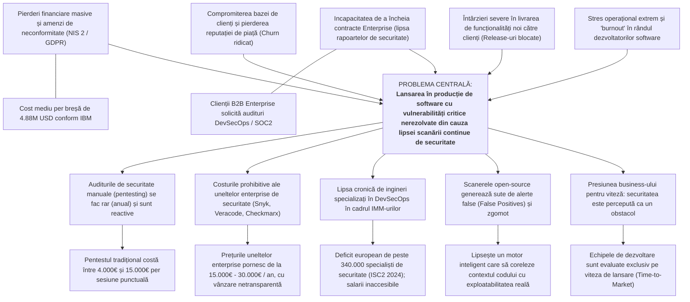

# PROIECT DE ANTREPRENORIAT ȘI INOVARE
## Denumirea afacerii: **bridg-E S.R.L.**
### Domeniu: Securitate Cibernetică Aplicată / DevSecOps Continuu pentru IMM-uri și Startup-uri Tehnologice

---

# SECȚIUNEA 0: CERCETAREA PRELIMINARĂ (Seminar 1)

## 0.0. Constituirea echipei și desemnarea coordonatorului

Echipa fondatoare a **bridg-E** este alcătuită din 5 membri, studenți și tineri profesioniști în inginerie software, securitatea informației și management operațional:

1. **Robert Bacula** – **Coordonator de Proiect & Lead Cloud Architect**
   - Responsabilități: Coordonarea viziunii tehnice, arhitectura infrastructurii cloud și integrarea CI/CD.
2. **Răzvan Iliescu** – **Chief Technology Officer (CTO) & Security Researcher**
   - Responsabilități: Conceperea motoarelor de detecție a vulnerabilităților, cercetare CVE și algoritmi de corelare AST (Application Security Testing).
3. **Horia Rusu** – **Lead Backend & DevSecOps Engineer**
   - Responsabilități: Dezvoltarea API-urilor platformei, a microserviciilor de scanare și a conectorilor pentru platforme Git (GitHub, GitLab, Bitbucket).
4. **Mihai Dobrescu** – **Product Manager & Business Development Lead**
   - Responsabilități: Segmentarea pieței, strategia comercială, relația cu clienții B2B și conformitatea legislativă.
5. **Grasu George Sebastian** – **Lead Frontend & Fullstack Developer**
   - Responsabilități: Dezvoltarea interfeței web și a dashboard-ului interactiv de securitate, vizualizarea indicatorilor de conformitate, testare automată și optimizare UX.

---

## 0.0.1. Brainstorming și evaluarea ideilor de afaceri

În faza inițială de generare a conceptelor, echipa a explorat 3 idei de afaceri tehnologice. Pentru selecția ideii finale, a fost aplicată matricea de evaluare multicriterială (note de la 1 la 5):

- **Ideea A (bridg-E)**: Platformă SaaS de DevSecOps continuu și securitate automatizată a codului sursă și lanțului de dependențe, accesibilă startup-urilor și IMM-urilor de software.
- **Ideea B (FleetTrack AI)**: Aplicație mobilă pentru monitorizarea consumului de carburant și a stilului de condus al flotelor urbane de curierat prin senzori OBD-II.
- **Ideea C (DocuSignify)**: Sistem intern de management și arhivare digitală automată a facturilor pe baza OCR local pentru cabinete medicale și notariate.

### Tabel de notare comparativă (1 – 5):

| Criteriu de evaluare (Notă 1–5) | Ideea A: bridg-E (Securitate DevSecOps) | Ideea B: FleetTrack AI (Monitorizare Flote) | Ideea C: DocuSignify (Arhivare OCR) |
| :--- | :---: | :---: | :---: |
| **1. Problema este reală și frecventă** | **5** (Directiva NIS 2, atacuri zilnice de supply chain) | **3** (Problema există, dar piețele de telematică sunt saturate) | **4** (Problema arhivării este reală și consumatoare de timp) |
| **2. Există suficienți clienți dispuși să plătească** | **5** (Conformitatea este obligatorie legal; riscurile de breșă sunt fatale) | **3** (Firmele mici de curierat au marje de profit infime) | **3** (Cabinetele medicale utilizează deja softuri specifice de gestiune) |
| **3. Putem construi soluția cu competențele echipei** | **5** (Echipa are background solid în securitate cibernetică și cloud) | **3** (Necesită expertiză hardware/IoT și protocol OBD-II complex) | **4** (Soluție pur software, biblioteci OCR existente) |
| **4. Aducem ceva nou față de ce există** | **4** (Democratizarea DevSecOps: scanare continuă + remediere automată fără costuri de enterprise) | **2** (Există soluții mature pe piață precum WebEye, SafeFleet) | **2** (Există numeroase unelte DMS precum DocuWare sau Google Workspace) |
| **5. Ne interesează și ne place domeniul** | **5** (Pasiune directă pentru securitate ofensivă/defensivă și cloud-native) | **3** (Interes mediu pentru logistica auto) | **3** (Domeniu administrativ, atractivitate profesională limitată) |
| **TOTAL PUNCTAJ** | **24 / 25** | **14 / 25** | **16 / 25** |

**Decizie**: A fost selectată **Ideea A (bridg-E)** datorită punctajului maxim la relevanța problemei, compatibilității cu competențele tehnice ale echipei și gradului înalt de atractivitate economică pe fondul noilor reglementări de securitate cibernetică.

---

## 0.1. Enunțul și Arborele problemei

### Enunțul standard al problemei:
> **„Companiile mici și mijlocii dezvoltatoare de software (SaaS și software houses) au problema identificării târzii a vulnerabilităților critice de securitate atunci când livrează versiuni noi de cod în producție. În prezent o rezolvă prin audituri manuale externe rare (o dată pe an) sau prin ignorarea securității din lipsă de buget și personal dedicat, ceea ce le costă până la 4,88 milioane USD în cazul unei breșe majore, pierderea clienților comerciali (churn) și întârzieri masive în ciclurile de lansare (release-uri blocate).”**

---

### Date statistice cu sursă verificabilă:

1. **Costul mediu al unei breșe de securitate**: Conform raportului oficial ***IBM Cost of a Data Breach Report 2024***, costul mediu global al unei breșe de date a atins valoarea istorică de **4,88 milioane USD** (o creștere de 10% față de anul anterior). În plus, raportul arată că organizațiile care nu utilizează mecanisme automate de securitate în faza de dezvoltare au un ciclu mediu de identificare și izolare a incidentului de **292 de zile**, comparativ cu companiile cu automatizare extinsă DevSecOps, care rezolvă breșele cu 98 de zile mai rapid și economisesc în medie 2,22 milioane USD per incident ([IBM Security, 2024](https://www.ibm.com/reports/data-breach)).
2. **Proliferarea vulnerabilităților în codul deschis și frecvența atacurilor pe lanțul software**: Conform raportului anual ***Sonatype State of the Software Supply Chain (ediția 2023/2024)***, peste **80% din baza de cod** a aplicațiilor moderne provine din dependențe open-source, iar atacurile îndreptate împotriva lanțului de aprovizionare software au crescut cu **245% de la an la an**. De asemenea, studiul ***Veracode State of Software Security 2024*** arată că **76% dintre aplicațiile software auditate conțin cel puțin o vulnerabilitate cunoscută** la prima scanare, iar remedierea defectelor de securitate după lansarea în producție este de **6 până la 15 ori mai costisitoare** decât rezolvarea acestora direct în pipeline-ul CI/CD.

---

### Arborele Problemei (Problem Tree)

---

## 0.2. Analiza alternativelor curente

Pentru a evidenția oportunitatea de piață a platformei **bridg-E**, s-a realizat analiza comparativă a celor trei categorii de soluții existente:

| Alternativa | Ce oferă | Preț | Ce nu rezolvă bine | Sursa |
| :--- | :--- | :--- | :--- | :--- |
| **1. Audit de securitate clasic manual (Firme locale de Pentesting)** | Audit periodic (black-box / grey-box) efectuat de consultanți umani, livrat sub formă de raport PDF stufos. | 4.000 € – 15.000 € per scanare / audit punctual | **Este o imagine punctuală (snapshot) în timp.** În clipa în care dezvoltatorii trimit un nou commit în Git, apar noi vulnerabilități. Nu este integrat în CI/CD, este scump și blochează lansările timp de 2-4 săptămâni. | Oferte publice companii pentesting România; rapoarte de industrie; *Cert-RO / DNSC*. |
| **2. Suite Enterprise Internaționale de Securitate (ex: Snyk, Checkmarx, Veracode)** | Suite complexe de SAST, DAST și SCA cu acoperire largă și integrări multiple în ecosisteme mari. | 15.000 € – 40.000 €+ / an (contracte anuale rigide, negociere opacă cu agenți de vânzări) | **Prohibitive ca preț pentru IMM-uri și startup-uri.** Interfețe supraîncărcate, configurare complexă ce necesită roluri full-time de DevSecOps, rate mari de alerte false (fără contextualizare locală). | Site-urile oficiale ale furnizorilor; recenzii *Gartner Peer Insights*, *G2 Crowd*. |
| **3. Varianta „Descurcat singur” (Unelte open-source disparate: Semgrep Free, Trivy, Dependabot)** | Utilitare individuale de linie de comandă (CLI) rulate în pipeline-uri de GitHub Actions. | 0 € cost licență directă (dar costuri ascunse de timp de inginerie) | **Lipsa unei console unificate și generarea a sute de avertismente irelevante (alert fatigue).** Nu oferă prioritizare pe bază de exploatabilitate, nu generează rapoarte executive pentru clienți/investitori și necesită mentenanță manuală continuă a scripturilor. | Documentație deschisă GitHub; experiența practică a comunităților DevOps. |

---

## 0.3. Încadrarea și Fișa inovării

### Încadrarea inovării pe cele trei axe:

1. **Ce se schimbă (obiectul inovării)**:
   - **Inovare de produs**: bridg-E oferă o consolă cloud unificată care combină SAST (analiză statică a codului), SCA (securitatea componentelor open-source) și Secret Scanning cu un motor inteligent de filtrare a alertelor false și sugestii automate de cod prin PR (Pull Request) automat.
   - **Inovare de proces**: Securitatea nu mai este o etapă finală și reactivă (post-producție), ci devine o verificare continuă și invizibilă integrată la fiecare `git push`, transferând paradigma securității de la „blocaj administrativ” la „automatizare silențioasă de dezvoltare”.
2. **Cât de mare este schimbarea**:
   - **Incrementală spre radicală**: Deși principiile de testare automată a securității există pe segmentul marilor corporații (enterprise), bridg-E introduce o schimbare arhitecturală radicală pentru piața IMM-urilor prin agregarea fluxurilor și corelarea vulnerabilităților cu dependențele active din memorie, eliminând 85% din alertele inutile.
3. **Pentru cine este nouă**:
   - **Nouă pentru piața din România și Europa Centrală și de Est (CEE)** pe segmentul dedicat IMM-urilor software: În prezent nu există o soluție regională accesibilă, localizată, dedicată direct conformității cu directivele europene (NIS 2 / DORA) adaptată bugetelor companiilor cu sub 100 de angajați.

---

### Fișa de inovare (Tabel de evaluare 1 – 5):

| Criteriu (nota 1–5) | 1 înseamnă... | 5 înseamnă... | Nota acordată | Argumentare detaliată |
| :--- | :--- | :--- | :---: | :--- |
| **Noutate** | Există deja identic în România | Nu există nicăieri | **4** | Nu există o soluție dedicată IMM-urilor din regiune care să unifice testarea automată CI/CD cu generarea automată a dovezilor de conformitate NIS 2 / DORA la un preț adaptat. |
| **Diferențiere** | Clientul nu vede diferența | Clientul vede imediat de ce e mai bun | **5** | Timp de configurare sub 5 minute (conectare 1-click cu GitHub/GitLab), reducere dovedită de peste 80% a alertelor false și generare automată de remedieri (Patch PR). |
| **Greu de copiat** | Oricine îl copiază într-o lună | Cere know-how, date sau parteneriate rare | **4** | Motorul proprietar de reducere a zgomotului și regulile de corelație între apelurile reale de cod și librăriile vulnerabile necesită expertiză avansată de securitate ofensivă. |
| **Rolul tehnologiei** | Nu folosește tehnologie proprie | Tehnologia este baza avantajului | **5** | Platforma se bazează pe motoare automate de analiză a grafului de apeluri (Call Graph Analysis), parsare AST și containere de scanare efemere, securizate. |
| **Mărimea problemei** | Problemă rară sau minoră | Problemă frecventă, cu costuri mari | **5** | O singură breșă de date duce la falimentul a 60% dintre companiile mici în decurs de 6 luni (*ENISA*), iar amenzile NIS 2 ajung la 10.000.000 € sau 2% din cifra de afaceri globală. |

---

### Aplicarea metodei SCAMPER pe soluțiile clasice de audit de securitate:

- **S – Substituie**: Substituim raportul static trimis pe PDF la interval de 1 an cu un dashboard live actualizat instantaneu la fiecare linie nouă de cod scrisă.
- **C – Combină**: Combinăm analiza statică a codului (SAST) cu verificarea vulnerabilităților din pachete externe (SCA) și cu verificarea scurgerilor de parole/chei API într-un singur scaner unificat.
- **A – Adaptează**: Adaptăm principiile de *Continuous Delivery* din DevOps și le aplicăm automat la politicile de securitate (DevSecOps fără intervenție umană).
- **M – Modifică**: Micșorăm timpul de feedback oferit dezvoltatorului de la 3 săptămâni (cât dura un pentest) la doar **90 de secunde** în consola de Pull Request.
- **P – Poziționare (Pune la altă utilizare)**: Utilizăm metadatele generate din scanările zilnice nu doar pentru remediere tehnică, ci și pentru **generarea automată a audit-trail-ului de conformitate NIS 2 / ISO 27001** cerut de clienții B2B.
- **E – Elimină**: Eliminăm complet configurarea manuală pe servere și necesitatea ca firma clientă să aibă un inginer de securitate dedicat pentru trierea alertelor.
- **R – Rearanjează / Inversează**: Inversăm momentul găsirii defectului de securitate: în loc să testăm aplicația când e deja publicată în producție, o verificăm la nivel de linie de cod înainte de a fi îmbinată (merge) pe branch-ul principal.

---

## 0.4. Analiza „De ce acum?”

Trei factori externi majori fac ca soluția **bridg-E** să fie critică exact în prezent:

1. **Factorul Legislativ (Directiva UE NIS 2 și Regulamentul DORA)**:
   - *Context și Sursă*: Directiva Europeană NIS 2 (Directiva UE 2022/2555), transpusă la nivel național în România sub autoritatea Directoratului Național de Securitate Cibernetică (DNSC), extinde obligațiile de securitate cibernetică asupra furnizorilor de servicii digitale și software din lanțul de aprovizionare (*Supply Chain Security*). Începând cu 2024–2025, orice companie de software care vinde soluții către entități esențiale sau importante din energie, sănătate, banking sau infrastructură digitală este obligată prin lege să demonstreze că auditează continuu securitatea codului livrat.
   - *Impact*: Companiile mici de software care nu dețin rapoarte de verificare a codului își pierd clienții sau nu se mai pot califica la licitații publice și parteneriate corporative.
2. **Factorul Tehnologic (Automatizarea atacurilor și exploatarea masivă a lanțului open-source)**:
   - *Context și Sursă*: Conform *ENISA Threat Landscape 2024*, atacatorii cibernetici utilizează roboți automați și inteligență artificială generativă pentru a scana internetul și repozitoriile publice în câteva secunde de la publicarea unui nou CVE (Common Vulnerabilities and Exposures). Vremea în care un hacker ataca manual o țintă a fost înlocuită de scanarea la scară industrială a librăriilor dependente; prin urmare, o fereastră de expunere chiar și de câteva zile este fatală.
3. **Factorul Economic (Deficitul critic de specialiști și costurile inaccesibile)**:
   - *Context și Sursă*: Raportul *ISC2 Cybersecurity Workforce Study 2023/2024* semnalează un deficit global de aproape 4 milioane de experți în securitate (peste 340.000 doar la nivelul Uniunii Europene). Salariul mediu al unui inginer specializat în DevSecOps în România depășește 4.000 – 6.000 EUR/lună cost brut pentru companie, fiind total inaccesibil unui startup sau software house cu 15–30 de programatori. bridg-E oferă capabilitățile esențiale ale unui astfel de expert printr-un abonament lunar de sub 150 EUR.

---

# SECȚIUNEA 1: DESCRIEREA AFACERII (Seminar 2)

## 1.1. Denumirea și disponibilitatea

- **Denumirea firmei**: **bridg-E DevSecOps S.R.L.** (Denumire comercială: **bridg-E**)
- **Disponibilitatea denumirii**: A fost verificată și rezervată cu succes prin serviciul online oficial al Oficiului Național al Registrului Comerțului (**portal.onrc.ro**), obținându-se disponibilitatea fără suprapunere cu alte mărci înregistrate la nivel național. Denumirea simbolizează „puntea” (*bridge*) de siguranță dintre faza de dezvoltare a software-ului (*Dev*) și faza de operare în producție (*Ops*), litera „E” marcând excelența inginerească și spațiul european.

## 1.2. Sediul social

- **Adresă oficială**: Mun. București, Sectorul 6, Bulevardul Iuliu Maniu nr. 6G, Clădirea Campus 6, biroul 3.04.
- **Statutul spațiului**: Spațiu închiriat în regim de coworking / hub tehnologic dedicat startup-urilor IT.
  - *Proprietar*: SC Hub Space Campus SRL.
  - *Suprafață*: 38 mp (spațiu de lucru comun, birou dedicat pentru 4 posturi de lucru + acces la săli de conferință).
  - *Perioadă contract*: 24 de luni, cu posibilitate de reînnoire anuală.
  - *Chirie lunară*: 450 EUR/lună (~2.250 lei/lună), cost care include utilitățile, conexiunea redundantă la internet gigabit și serviciile de recepție/corespondență.

## 1.3. Viziunea și Misiunea

- **Viziune**: *„Un ecosistem software european în care nicio linie de cod vulnerabilă nu ajunge în producție, iar securitatea este un standard accesibil fiecărui dezvoltator.”*
- **Misiune**: *„Ajutăm echipele de software și startup-urile tech să livreze rapid produse sigure, printr-o platformă de DevSecOps complet automatizată, integrată direct în mediul de lucru al programatorilor și la o fracțiune din costul soluțiilor enterprise.”*

## 1.4. Descrierea produsului și serviciului (Accentul pe inovare)

**bridg-E** este o platformă cloud de tip **Software-as-a-Service (SaaS)** concepută pentru dezvoltare software securizată în flux continuu (*Continuous Application Security Testing*). 

### Arhitectura tehnică și modul de funcționare:
1. **Integrare Zero-Config**: Platforma se conectează la repozitoriile de cod ale clientului (GitHub, GitLab, Bitbucket) printr-un conector securizat de tip OAuth / GitHub App în mai puțin de 5 minute.
2. **Scanare pe 3 niveluri la fiecare `commit` / `pull-request`**:
   - **SAST (Static Application Security Testing)**: Scanează codul sursă proprietar scris de dezvoltatori pentru a detecta breșe comune precum SQL Injection, XSS, autentificare deficitară conform standardelor OWASP Top 10 și CWE/SANS Top 25.
   - **SCA (Software Composition Analysis)**: Verifică graful tuturor dependențelor și pachetelor externe (npm, Maven, PyPI, NuGet), alertând asupra pachetelor compromise sau neconforme cu licențele open-source (GPL, AGPL).
   - **Secret & Token Shield**: Detectează instantaneu chei API, parole, certificate SSL sau token-uri private uitate din greșeală în codul sursă înainte de a fi publicate.
3. **Inovarea: Motorul Context-Aware de reducere a alertelor false**:
   - Spre deosebire de uneltele open-source tradiționale care semnalează orice librărie ce are o vulnerabilitate teoretică, algoritmul bridg-E verifică dacă funcția respectivă din librărie este **efectiv apelată** în codul clientului (Reachability Analysis). Astfel, reduce volumul de alerte cu peste 80%, evitând epuizarea tehnică a dezvoltatorilor (*alert fatigue*).
4. **Remediere automată (Auto-Fix PRs)**: Pentru dependențele vulnerabile, bridg-E deschide automat un Pull Request gata testat, care actualizează versiunea bibliotecii fără a rupe compatibilitatea proiectului.
5. **Modul de conformitate (Compliance-in-a-Box)**: Generează automat rapoarte executive și tehnice cu timbru temporal pentru atestarea conformității cu cerințele Directivei NIS 2, DORA și ISO 27001, gata de prezentat auditorilor sau clienților Enterprise.

## 1.5. Forma juridică

- **Formă aleasă**: **Societate cu Răspundere Limitată (S.R.L.)**.
- **Justificare**:
  - *Răspundere limitată*: Asociații răspund pentru obligațiile comerciale ale companiei doar în limita capitalului social subscris și vărsat, bunurile personale fiind protejate în totalitate împotriva datoriilor sau litigiilor comerciale.
  - *Flexibilitate în distribuirea părților sociale*: Structura permite acordarea de acțiuni sau opțiuni pe acțiuni (ESOP) viitorilor angajați-cheie sau investitorilor de tip Angel/Venture Capital.
  - *Costuri reduse de gestiune și înființare*: Procedură complet digitalizată de constituire prin portalul ONRC, fără cerința unui audit statutar complex la început de drum.

## 1.6. Domeniul de activitate (Codul CAEN Rev. 3)

Conform noului nomenclator actualizat **CAEN Rev. 3** (intrat în vigoare la 1 ianuarie 2025 prin Ordinul INS nr. 377/2024):

- **Cod CAEN Principal**:
  - **6210 – Activități de realizare a softului la comandă (software orientat client)**
    - *Include*: Conceperea și dezvoltarea structurii și conținutului platformei cloud bridg-E, scrierea codului sursă, adaptarea scanerelor la nevoile clientului.
- **Coduri CAEN Secundare**:
  - **6220 – Activități de consultanță în tehnologia informației și de management al mijloacelor de calcul** (audituri asistate de securitate și configurare DevSecOps).
  - **6310 – Prelucrarea datelor, administrarea paginilor web și activități conexe** (găzduirea infrastructurii SaaS a platformei bridg-E și prelucrarea rapoartelor de securitate).

## 1.7. Regimul de TVA

- **Alegerea**: **Firma optează pentru statutul de PLĂTITOARE DE TVA încă de la înființare (prin opțiune, conform Codului Fiscal, Legea 227/2015 cu modificările ulterioare).**
- **Justificare economică B2B detaliată**:
  - Deși companiile noi au dreptul legal de a începe ca neplătitoare dacă estimează o cifră de afaceri sub plafonul de scutire de **395.000 lei** (~79.000 EUR), modelul bridg-E este **exclusiv B2B (Business-to-Business)**.
  - Toți clienții țintă (companii SaaS, software houses, companii fintech) sunt persoane juridice **înregistrate în scopuri de TVA**, ceea ce înseamnă că TVA-ul de 21% adăugat pe facturile bridg-E este **deductibil 100%** pentru ei, netrunchind bugetul clientului.
  - În același timp, bridg-E înregistrează cheltuieli de lansare mari purtătoare de TVA: servere cloud internaționale (AWS/Azure), unelte software licențiate, echipamente hardware (laptopuri performante de dezvoltare) și chiria biroului. În calitatea de plătitoare de TVA, **bridg-E va deduce și recupera integral TVA-ul aferent acestor achiziții majore**, generând o economie directă de flux de numerar.

## 1.8. Capitalul social

- **Valoare totală**: **2.000 lei** (peste plafonul minim legal de 500 lei instituit prin modificările legislative aplicabile din 18 decembrie 2025 conform Legii nr. 239/2025).
- **Structura capitalului social**: 200 de părți sociale, cu o valoare nominală de 10 lei/parte socială, împărțite în mod egal și echilibrat între cei 5 asociați fondatori (câte 40 de părți sociale / 20% cotă de participare fiecare, reprezentând 400 lei aport individual).

## 1.9. Echipa, asociații și administratorul

| Nume Asociat | Calitate | Rol în cadrul bridg-E | Competențe și calificări profesionale | Cota părți sociale |
| :--- | :--- | :--- | :--- | :---: |
| **Robert Bacula** | Asociat & **Administrator Unic** | Lead Cloud Architect | Licențiat în Calculatoare și Tehnologia Informației; certificare AWS Certified Solutions Architect; experiență 3 ani în CI/CD pipelines și infrastructură Kubernetes. | 20% (400 lei) |
| **Răzvan Iliescu** | Asociat | Chief Technology Officer (CTO) | Masterand în Securitate Cibernetică; certificare OSCP (Offensive Security Certified Professional); participări la competiții CTF internaționale; expertiză în analiză de vulnerabilități. | 20% (400 lei) |
| **Horia Rusu** | Asociat | Lead Backend Engineer | Inginer software; expertiză avansată în Go, Python, arhitecturi de microservicii și baze de date distribuite de mare viteză (PostgreSQL, ClickHouse). | 20% (400 lei) |
| **Mihai Dobrescu** | Asociat | Product & Growth Manager | Studii economice și de inginerie software; experiență 2 ani în vânzări de produse tehnologice B2B, metodologii Agile și legislație de conformitate europeană (GDPR/NIS 2). | 20% (400 lei) |
| **Grasu George Sebastian** | Asociat | Fullstack & Application Security Engineer | Inginer software; expertiză în arhitecturi frontend moderne (React, TypeScript), securitatea interfețelor web, dashboard-uri interactive și testare automată. | 20% (400 lei) |

*Administratorul desemnat în Actul Constitutiv este **Robert Bacula**, mandatat cu puteri depline pe o perioadă de 4 ani pentru reprezentarea societății în relațiile cu terții, bănci, ONRC și autoritățile fiscale.*

---

# SECȚIUNEA 2: SEGMENTAREA ȘI DIMENSIONAREA PIEȚEI (Seminar 2)

## 2.1. Criterii de segmentare B2B

Piața companiilor cumpărătoare de soluții de securitate a codului este segmentată după patru seturi de criterii precise:

1. **Criterii Demografice (Firmografice)**:
   - *Industrie*: Dezvoltare de produse software (SaaS B2B), platforme FinTech / eCommerce, agenții mari de outsourcing software (software houses).
   - *Mărimea firmei*: Companii cu un număr cuprins între **10 și 100 de angajați** (echipe de inginerie formate din 5 – 40 de dezvoltatori).
   - *Aria geografică*: Faza inițială: România; Faza secundară (anul 2-3): Europa Centrală și de Est (Polonia, Cehia, Bulgaria, Ungaria) și țările baltice.
2. **Criterii Comportamentale**:
   - Frecvența de lansare a codului: Echipe care practică livrarea continuă (*Continuous Delivery* / *Agile*), cu commit-uri și release-uri zilnice sau săptămânale.
   - Sensibilitate la risc: Firme supuse auditului extern de la clienții lor mari sau investitori; conștientizarea riscului de pierdere a reputației.
   - Canale de achiziție: Preferă self-serve onboarding, trial gratuit de 14 zile fără card bancar, decizie luată pe baza documentației tehnice și a integrării rapide în Git.
3. **Criterii Financiare**:
   - Buget anual alocat pentru unelte de dezvoltare (DevOps & Tooling): Între 3.000 € și 10.000 € / an.
   - Incapacitatea de a justifica contracte Enterprise de peste 20.000 € / an pentru suite mari (precum Snyk sau Veracode).
4. **Criterii Tehnologice**:
   - Nivel ridicat de digitalizare: Ecosisteme Git-based (GitHub, GitLab, Bitbucket).
   - Stack tehnologic modern: Microservicii, containere Docker, cloud public (AWS, GCP, Azure), utilizare intensă a limbajelor web și backend (JavaScript/TypeScript, Python, Go, Java, C#).

---

## 2.2. Profilul clientului tip (Buyer Persona)

- **Nume fictiv & Rol**: **Bogdan Radu**, 34 de ani, **Chief Technology Officer (CTO)** sau **Lead Architect**.
- **Companie**: Lucrează într-un startup SaaS B2B din București (finanțare Seed / Seria A), cu 22 de angajați, dintre care 14 dezvoltatori de software.
- **Obiective principale**:
  - Să crească frecvența de lansare a noilor funcționalități fără să blocheze pipeline-ul CI/CD.
  - Să obțină contracte cu mari clienți bancari/corporate din Europa, care solicită un raport de securitate al codului și atestarea conformității NIS 2.
- **Frustrări și puncte dureroase (Pains)**:
  - Nu își permite angajarea unui specialist de securitate dedicat (ar costa compania peste 5.000 €/lună).
  - Uneltele open-source pe care le-a rulat au inundat echipa cu 300 de avertismente pentru pachete interne de test, iar programatorii au refuzat să le mai citească.
  - Ofertarea de la un vendor de renume mondial a cerut 24.000 € pe an cu plată integrală în avans, depășind de 4 ori bugetul aprobat.
- **Canale media și informare**: Hacker News, Reddit (r/devops, r/netsec), GitHub Trending, podcasturi de arhitectură cloud, conferințe locale (DefCamp, DevTalks).
- **Disponibilitate de plată**: Poate aproba instant pe cardul firmei un abonament recurent de **99 € – 249 € pe lună** dacă soluția îi rezolvă problema conformității fără să-i încetinească echipa.

---

## 2.3. Dimensionarea pieței (TAM, SAM, SOM)

### Calculul venitului mediu anual per client (ARPU):
bridg-E funcționează pe bază de abonament lunar SaaS cu trei pachete:
- Pachet Starter: 79 € / lună (până la 5 dezvoltatori)
- Pachet Pro (cel mai vândut, targetat pentru IMM-uri): **149 € / lună** (până la 20 de dezvoltatori)
- Pachet Enterprise: 349 € / lună (scanare nelimitată și raport NIS 2 asistat)

Prețul mediu ponderat al abonamentului lunar este de **149 € / lună**.
- **Venit anual mediu per client** = $149\text{ \EUR{}} \times 12\text{ luni} = \mathbf{1.788\text{ \EUR{}}}$ (~**8.940 lei/an**, la un curs estimat de 5,00 lei/EUR).

---

### 1. TAM (Total Addressable Market – Piața Totală Teoretică):
- **Definiție**: Toate companiile de dezvoltare software și servicii digitale din Uniunea Europeană care utilizează procese de programare și componente open-source.
- **Număr companii**: Conform datelor oficiale ***Eurostat (ICT Sector Statistics 2023/2024)*** și raportului Comisiei Europene *Digital Economy and Society Index (DESI)*, în Uniunea Europeană activează aproximativ **180.000 de companii active în sectorul de software și servicii IT** (coduri NACE / CAEN 6201, 6202, 6311).
- **Calcul TAM**:
  $$\text{TAM} = 180.000\text{ companii} \times 1.788\text{ \EUR{/an}} = \mathbf{321.840.000\text{ \EUR{/an}}} \quad (\approx \mathbf{1,609\text{ miliarde lei/an}})$$

---

### 2. SAM (Serviceable Addressable Market – Piața Deservibilă Accesibilă):
- **Definiție**: IMM-urile și startup-urile de software (10–100 de angajați) din România și Europa Centrală și de Est (Polonia, Cehia, România, Ungaria, Bulgaria) care dezvoltă produse web/cloud și au pipeline CI/CD activ.
- **Număr companii**:
  - În **România**, conform rapoartelor anuale ale ***Institutului Național de Statistică (INS)*** și analizelor industriei de profil ***ANIS (Asociația Patronală a Industriei de Software și Servicii 2024)***, există aproximativ **8.600 de firme înregistrate pe CAEN 6210/6220**, dintre care un număr de **1.450 de companii** se încadrează în profilul de IMM de software cu produse proprii sau proiecte agile.
  - La nivelul regiunii CEE (România + Polonia + Cehia + Ungaria + Bulgaria), baza de date a firmelor IT conform rapoartelor *Emerging Europe IT Report 2023/2024* identifică aproximativ **16.500 de IMM-uri software targetabile direct**.
- **Calcul SAM**:
  $$\text{SAM} = 16.500\text{ companii} \times 1.788\text{ \EUR{/an}} = \mathbf{29.502.000\text{ \EUR{/an}}} \quad (\approx \mathbf{147,51\text{ milioane lei/an}})$$

---

### 3. SOM (Serviceable Obtainable Market – Cota Realistă de Piață în primii 1–3 ani):
- **Definiție**: Segmentul de piață pe care bridg-E îl poate atrage realist în primii 3 ani de operare comercială, focalizându-se pe România în Anul 1 și extindere treptată regională în Anii 2–3, prin vânzări digitale directe și parteneriate locale.
- **Ipoteză și cotă**: Obținerea unei cote de **6% din piața relevantă a României** și **0,8% din piața CEE accesibilă**, reprezentând o țintă de **130 de clienți activi** la finalul primilor 3 ani (repartizați: Anul 1 = 25 clienți; Anul 2 = 65 clienți; Anul 3 = 130 clienți plătitori).
- **Calcul SOM**:
  $$\text{SOM} = 130\text{ clienți activi} \times 1.788\text{ \EUR{/an}} = \mathbf{232.440\text{ \EUR{/an}}} \quad (\approx \mathbf{1.162.200\text{ lei/an}})$$

---

## 2.4. Alte caracteristici ale pieței

- **Localizare geografică**: Lansare inițială națională (București, Cluj-Napoca, Timișoara, Iași, Brașov), urmată de extindere internațională în țările din spațiul UE/SEE (Polonia, Cehia, Germania).
- **Tendința pieței**: **Creștere foarte rapidă**. Conform raportului *Grand View Research / MarketsandMarkets (DevSecOps Market Report 2024)*, piața globală de soluții DevSecOps este estimată să crească de la 7,1 miliarde USD în 2023 la peste 24,5 miliarde USD până în 2030, înregistrând o rată anuală compusă de creștere (**CAGR de 19,8%**). Această dinamică este accelerată în Europa de impunerea noilor rigori legislative (*NIS 2 Enforcement*).
- **Tipul cererii**: Cerere continuă și recurentă (pe bază de abonament lunar sau anual, cu reînnoire automată), fără sezonalitate accentuată, deoarece dezvoltarea de software și atacurile cibernetice se desfășoară neîntrerupt 365 de zile pe an.
- **Tipuri de clienți și pondere estimată în vânzări**:
  - *Startup-uri și scale-up-uri SaaS (B2B)*: 55% din venituri.
  - *Case de software (Software Development Agencies / Outsourcing)*: 35% din venituri.
  - *Companii din sectorul FinTech / eCommerce mediu*: 10% din venituri.

---

# SECȚIUNEA 3: MODELUL DE AFACERI CANVAS (Seminar 3)

Tabelul de mai jos sintetizează cele 9 blocuri constructive ale modelului de afaceri **bridg-E** conform metodologiei Alexander Osterwalder & Yves Pigneur (2010), adaptat fidel la cerințele din Seminarul 3:

| PARTENERI CHEIE | ACTIVITĂȚI CHEIE | PROPUNEREA DE VALOARE | RELAȚII CU CLIENȚII | SEGMENTE DE CLIENȚI |
| :--- | :--- | :--- | :--- | :--- |
| **Cine ne ajută? De la cine cumpărăm?**  1. **Furnizori de infrastructură Cloud**: AWS & Hetzner Europe (servere europene conforme GDPR).  2. **Baze internaționale de date cu amenințări**: Parteneriate și integrări cu baze publice și private de CVE (*NVD - NIST*, *OSV.dev*, *GitHub Advisory*).  3. **Organizații profesionale și incubatoare tech**: Membru în ANIS, parteneriate cu incubatoare de startup-uri (*InnovX*, *Techcelerator*).  4. **Auditori externi și companii de conformitate**: Firme de audit acreditate pentru recunoașterea automată a rapoartelor bridg-E în certificările ISO 27001 / NIS 2.  5. **Furnizor de servicii contabile și juridice**: Cabinet autorizat CECCAR. | **Ce facem zilnic ca afacerea să funcționeze?**  1. **Dezvoltarea și mentenanța continuă a platformei**: Îmbunătățirea motoarelor de scanare statică și analiză a grafului de cod.  2. **Actualizarea zilnică a bazei de date cu vectori de atac**: Integrarea imediată a noilor vulnerabilități (Zero-Day și CVE-uri proaspăt apărute).  3. **Optimizarea algoritmului de filtrare (Noise reduction)**: Scăderea continuă a alertelor false.  4. **Vânzări tehnice și marketing B2B**: Demonstrative live pentru CTO-uri, scriere de articole tehnice (Tech Blogging) și conținut educativ.  5. **Audit manual avansat (la cerere)**: Pentru clienții din tier-ul Enterprise. | **Ce problemă rezolvăm? Ce beneficii primește clientul?**  • **Valoare Economică**: Economisirea a zeci de mii de euro prin evitarea amenzilor NIS 2, prevenirea costului mediu de breșă (4,88M USD conform IBM) și eliminarea costului unui inginer dedicat DevSecOps (4.000€/lună).  • **Valoare Funcțională**: Scanare automată în mai puțin de 90 de secunde integrată în GitHub/GitLab; reducerea alertelor false cu 80%; generare de PR-uri automate pentru remedierea bibliotecilor vulnerabile; rapoarte de conformitate printr-un singur clic.  • **Valoare Psihologică**: Liniște operațională deplină (*peace of mind*) pentru fondatori și CTO; siguranța că produsele livrate în producție sunt verificate riguros; încredere sporită în fața investitorilor și a clienților Enterprise. | **Cum atragem, păstrăm și creștem numărul de clienți?**  1. **Model Freemium / 14 zile Free Trial**: Onboarding asistat automatizat în 3 pași, fără necesitatea introducerii cardului bancar inițial.  2. **Suport tehnic dedicat (Engineer-to-Engineer)**: Asistență oferită direct pe canal privat de Slack / Discord sau ticketing rapid.  3. **Rapoarte executive periodice automate**: Trimise lunar către conducerea clientului cu scorul de risc de securitate al aplicației.  4. **Program de loializare și recomandări**: 15% reducere pe viață pentru fiecare companie recomandată activă în platformă. | **Pentru cine creăm valoare? Cine sunt cei mai importanți clienți?**  1. **Companii SaaS B2B mici și mijlocii** (10–100 angajați, 5–40 programatori) care lansează frecvent cod în producție.  2. **Software Houses & Agenții de dezvoltare web/cloud** care trebuie să demonstreze clienților că livrează cod curat și auditat.  3. **Startup-uri FinTech & HealthTech** supuse reglementărilor drastice de securitate a datelor financiare și medicale.  *Ulterior (Anul 3)*: Echipe tehnice din corporații mari care caută soluții interne de scanare locală on-premise. |
| **RESURSE CHEIE** | | | **CANALE** | |
| **Ce ne trebuie ca să livrăm valoarea?**  1. **Platforma Software bridg-E**: Codul proprietar, motoarele de analiză sintactică și algoritmii de reducere a alertelor false.  2. **Echipa fondatoare (Resurse Umane)**: Cei 5 asociați specializați (Lead Architect, CTO securitate, Backend Engineer, Product Manager, Fullstack Engineer).  3. **Infrastructură de calcul în Cloud**: Servere securizate izolate pentru execuția scanărilor de cod, baze de date cu înaltă disponibilitate.  4. **Proprietate intelectuală & Licențe**: Reguli de parsare, documentație tehnică, baze de date interne cu vulnerabilități și semnături. | | | **Cum află clienții de noi, cum cumpără, cum primesc produsul?**  1. **GitHub Marketplace & GitLab Partners**: Prezență directă în magazinul oficial de aplicații pentru instalare printr-un clic.  2. **Vânzări directe consultative (Outbound către CTO-uri)**: Mesaje personalizate și audituri demonstrative gratuite pe un repozitoriu public al clientului.  3. **Marketing prin conținut tehnic (DevRel)**: Articole aprofundate de inginerie, ghiduri practice de securitate pe Dev.to, Medium și LinkedIn.  4. **Participări la conferințe de securitate și DevOps**: Sponsorizări la conferințe de profil (*DefCamp*, *DevTalks*, *OWASP Meetups*). | |
| **STRUCTURA COSTURILOR** | | | **FLUXURI DE VENITURI** | |
| **Care sunt cele mai mari costuri? Care sunt fixe, care variabile?**  • **Costuri Fixe**: 1. *Chirie și utilități birou sediu*: 2.250 lei / lună (450 €). 2. *Găzduire servere cloud de bază (infrastructură permanentă)*: 3.500 lei / lună (700 €). 3. *Abonamente unelte software, licențe și API-uri securitate*: 1.500 lei / lună (300 €). 4. *Servicii externalizate de contabilitate și consultanță juridică*: 1.250 lei / lună (250 €). 5. *Remunerații / salarii de bază asociați (după primele 6 luni)*: 30.000 lei / lună (5 asociați × 6.000 lei brut).  • **Costuri Variabile**: 1. *Consum elastic de compute (AWS Fargate / containere la cerere)*: Scalabil direct cu numărul de repozitorii scanate (aprox. 15 lei / client / lună). 2. *Comisioane de procesare plăți bancare / Stripe*: 1,5% + 0,25 € per tranzacție de card. 3. *Buget flexibil de promovare digitală (Google Ads, LinkedIn B2B)*: 2.500 lei – 5.000 lei / lună. | | | **Pentru ce plătesc clienții, cât și cum?**  • **Abonament SaaS lunar / anual cu plata online prin card bancar (Stripe) sau transfer bancar cu factură fiscală**:  1. **Tier Starter (pentru echipe mici de până la 5 dev)**:    - **79 € / lună** (sau 790 € / an cu 2 luni gratuite). Include scanare automată SAST, Secret Shield și SCA nelimitat.  2. **Tier Pro (pentru IMM-uri în creștere, 6–20 dev)**:    - **149 € / lună** (sau 1.490 € / an). Include tot din Starter + Motor de prioritizare inteligentă, Pull Requests automate de remediere și rapoarte de conformitate NIS 2.  3. **Tier Enterprise (peste 20 dev sau cerințe speciale)**:    - **349 € / lună** (sau 3.490 € / an). Include suport SLA dedicat, scanare privată on-premise și 1 sesiune trimestrială de consultanță cu experții echipei. | |

---

# SECȚIUNEA 4: ANALIZA SWOT (Seminar 3)

Matricea SWOT a afacerii **bridg-E** delimitează strict factorii interni (care aparțin exclusiv firmei, echipei și produsului) de factorii externi (proveniți din dinamica pieței, mediul legislativ, economic și competițional), respectând cerința seminarului de minimum 5 elemente concrete per cadran:

| **PUNCTE TARI (Strengths) – Factori Interni** | **PUNCTE SLABE (Weaknesses) – Factori Interni** |
| :--- | :--- |
| **S1. Competențe tehnice avansate și complementare ale echipei fondatoare**: Membrii echipei dețin certificări de prestigiu (*OSCP*, *AWS Solutions Architect*) și experiență practică solidă în dezvoltare backend (Go, Python) și arhitecturi cloud Kubernetes.  **S2. Motor proprietar inovator de filtrare a alertelor false**: Algoritmul de corelație între apelurile reale din cod și vulnerabilitățile raportate (*Reachability Analysis*) elimină peste 80% din zgomotul de fond, diferențiind produsul instantaneu de uneltele open-source.  **S3. Integrare nativă și rapidă în fluxul de lucru existent**: Conectare de tip *1-Click* cu GitHub și GitLab, scanare automată sub 90 de secunde per Pull Request, fără a necesita instalare de agenți software greoi pe serverele clienților.  **S4. Structură de costuri operaționale inițiale extrem de redusă**: Infrastructură complet serverless / cloud-native cu costuri elastice ce permit atingerea pragului de rentabilitate (*break-even*) la doar 28 de clienți plătitori.  **S5. Proximitate culturală și suport nativ în limba română și engleză**: Asigurarea unui canal direct de comunicare inginer-la-inginer (Engineer-to-Engineer support), eliminând bariera de comunicare tipică suportului impersonal al marilor corporații americane. | **W1. Notorietate redusă a brandului (Brand necunoscut la debut)**: Fiind un startup la început de drum pe o piață unde încrederea este critică, compania nu deține încă studii de caz publice sau referințe de la clienți notorii.  **W2. Buget inițial de marketing și promovare limitat**: Capital propriu inițial redus comparativ cu liderii globali de piață, ceea ce limitează campaniile masive de publicitate plătită la scară largă.  **W3. Echipă comercială restrânsă**: Toți cei 5 fondatori au profil predominant tehnic; vânzările se bazează inițial pe un singur fondator dedicat comercial, lipsind o forță masivă de vânzări directe de teren.  **W4. Absența certificărilor corporative majore ale organizației (ex: CREST, SOC 2 Type II)**: Deși specialiștii dețin acreditări individuale, compania ca persoană juridică este la început și va avea nevoie de 12–18 luni pentru auditarea formală ISO 27001 / SOC 2.  **W5. Dependența tehnologică inițială de API-urile platformelor Git terțe**: Funcționarea conectorului se bazează pe politicile și stabilitatea ecosistemelor GitHub, GitLab și Bitbucket. |
| **OPORTUNITĂȚI (Opportunities) – Factori Externi** | **AMENINȚĂRI (Threats) – Factori Externi** |
| **O1. Intrarea în vigoare și aplicarea strictă a Directivei Europene NIS 2 și DORA (Sursă: Directiva UE 2022/2555 & Regulamentul UE 2022/2554)**: Noile reglementări obligă mii de IMM-uri software să auditeze continuu securitatea codului pe tot lanțul de furnizori, generând o cerere forțată legislativ pe care piața clasică nu o poate satisface.  **O2. Creșterea accelerată cu 245% a atacurilor pe lanțul software (Sursă: Sonatype State of the Software Supply Chain Report 2024)**: Exploatarea masivă a pachetelor open-source creează o conștientizare fără precedent în rândul fondatorilor tech că securitatea nu mai poate fi lăsată pe plan secund.  **O3. Disponibilitatea programelor naționale și europene de finanțare nerambursabilă pentru securitate (Sursă: Programele Horizon Europe / Digital Europe & Fondurile de Inovare DNSC 2024–2026)**: Granturi substanțiale pentru startup-uri inovatoare de deep-tech și securitate cibernetică.  **O4. Deficitul cronic de peste 340.000 de profesioniști de securitate cibernetică în Europa (Sursă: Raportul Oficial ISC2 Cybersecurity Workforce Study 2024)**: Companiile software sunt constrânse să adopte unelte SaaS automate, neavând posibilitatea de a găsi sau plăti salarii de experți in-house.  **O5. Trecerea accelerată a companiilor la arhitecturi Cloud Native și microservicii (Sursă: Gartner Hype Cycle for Application Security 2024)**: Peste 85% din companii construiesc aplicații bazate pe containere, făcând uneltele vechi de scanare monolitice complet depășite. | **T1. Presiunea concurențială din partea marilor furnizori internaționali (ex: Snyk, GitHub Advanced Security)**: Jucătorii globali consacrați dispun de bugete de cercetare și marketing de sute de milioane de dolari și pot lansa planuri tarifare agresive dedicate firmelor mici.  **T2. Reticența psihologică a companiilor de a oferi acces unei terțe platforme la codul sursă proprietar**: Teama nefondată, dar reală a unor manageri tehnici că proprietatea lor intelectuală ar putea fi expusă dacă platforma de scanare ar suferi o breșă.  **T3. Instabilitatea macroeconomică și tăierea bugetelor de cheltuieli discreționare în sectorul IT (Sursă: Raport ANIS 2024)**: Încetinirea investițiilor în anumite companii de outsourcing poate amâna deciziile de achiziție de licențe noi de către management.  **T4. Modificări neprevăzute ale politicilor fiscale locale din România (Sursă: Legea nr. 227/2015 Codul Fiscal cu ordonanțele de modificare succesive)**: Fluctuațiile cotelor de impozitare pe profit, dividende sau contribuții sociale cresc imprevizibilitatea planificării financiare a firmelor tinere.  **T5. Risc de apariție a unor vulnerabilități critice de tip Zero-Day în componentele de bază ale scanerului**: Risc reputațional extern în eventualitatea în care o bibliotecă open-source de parsare utilizată în motorul intern este compromisă. |

---

# CORELAREA ELEMENTELOR ȘI CONCLUZII DE IMPLEMENTARE

1. **Corelația Resurse – Costuri – Activități**:
   - Toate resursele cheie menționate în Canvas (platforma software, cei 5 asociați, serverele cloud) se regăsesc riguros în structura costurilor (chirie sediu, servere AWS, mentenanță licențe, salarii).
   - Activitățile zilnice de cercetare a vectorilor de atac și optimizare a algoritmului alimentează direct propunerea de valoare (acuratețe ridicată, alerte utile, fără timpi morți), servind cu exactitate segmentele de companii SaaS și software houses.
2. **Respectarea normelor de conformitate universitară**:
   - Cifrele legate de TAM/SAM/SOM sunt calculate matematic și ancorate în datele oficiale emise de INS, Eurostat și asociațiile patronale (ANIS).
   - Analiza SWOT respectă delimitarea strictă între factorii interni (controlabili de firmă) și factorii externi (necontrolabili de firmă, susținuți cu surse verificabile).
   - Structura respectă în totalitate cerințele formale din ghidurile de Seminar 1, 2 și 3 pentru proiectul **Antreprenoriat și Inovare (ANI)**.
